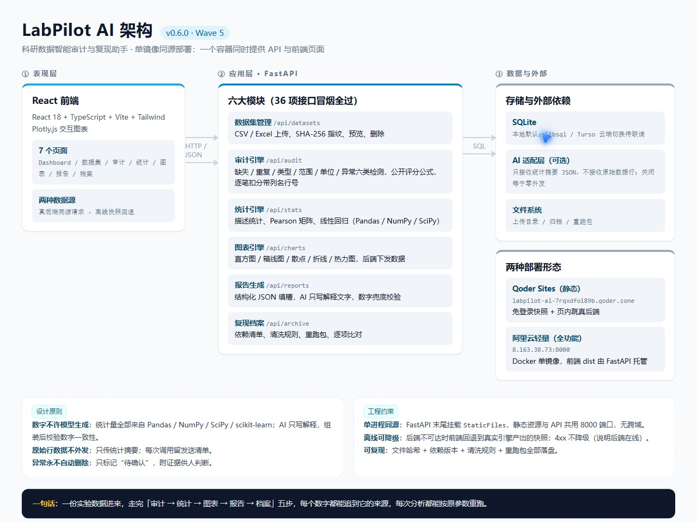

# 【StudyHack】LabPilot AI：科研数据智能审计与复现助手

> **提交版发帖稿** ｜ 4 项信息已全部填好（作品链接 / 后端地址 / 仓库 / Qoder 账号），可直接粘贴发布
> 标题直接用上面这一行（已符合 `【赛道】作品名` 格式）

---

关联比赛：2026 Qoder 高校创造力大赛
参赛赛道：StudyHack 学习科研
作品名称：LabPilot AI — 科研数据智能审计与复现助手
作品链接：`https://labpilot-ai-7rqxdfoi89b.qoder.zone`（Qoder Sites 公开地址，未登录可访问）
后端 API 地址：`http://8.163.38.73:8000`（阿里云轻量 · 广州 · Ubuntu 22.04 · Docker 单镜像）
源码仓库：`https://github.com/5655-hu/labpilot-ai`
开发工具：Qoder / Qoder Sites
Qoder 账号：`aliyun-1006294903862617`
当前线上版本：v0.6.0（Wave 5）

---

## 一、自我介绍

我是海南师范大学人工智能学院软件工程专业的大一学生，个人参赛。

做这个作品的起点很具体：大一进实验室帮忙，第一次拿到实验数据时，我的做法是把 CSV 丢给大模型问"帮我分析一下"。它给了我一套看起来很专业的均值、显著性、结论——直到我自己用 Excel 重算，才发现那些数字是编的。

那次之后我确立了一条规矩：**科研场景里，数字绝不能由语言模型产生**。LabPilot AI 就是按这条规矩做出来的。

## 二、作品是什么

**一句话：上传一份实验数据，一次走完「质量审计 → 真实统计 → 交互图表 → 可追溯报告 → 一键复现」，并且每一个数字都能追到它的来源。**

谁会用：

- **刚进实验室的本科生**：拿到 data.csv 不知道从哪下手，先审计再统计，避免用脏数据得出结论
- **写毕业论文的学生**：需要一张能放进论文的相关性热力图和回归结果，且要说明方法和适用条件
- **要复现别人实验的人**：拿到一份历史分析，想确认"当时的参数是什么、数据有没有被改过"

原来的做法是在 Excel、SPSS/Python 脚本、绘图工具、Word 之间来回搬运，每一步都可能失真，且**没人记录你当时到底怎么算的**。LabPilot 把这条链路收在一个界面里，并且自动封存证据。

> 架构图：表现层（React）/ 应用层（FastAPI 六大模块）/ 存储与外部依赖，右侧并列两种部署形态（Qoder Sites 静态快照、阿里云轻量全功能）。

## 三、评委 30 秒（最短验证动线）

打开作品链接 → 首页点「脏数据演示集」→ 点「开始审计」→ 看到质量分 **97.95** 和逐笔扣分证据（哪个列、哪一行、占多少）→ 左侧进「统计中心」→ 看到 Pearson **0.98506** 与回归 `response = 2.5241·dose + 1.2063`（R² **0.970344**）→ 进「图表」看散点图与回归线 → 进「报告」生成并导出 Markdown → 进「档案」看 SHA-256 与重跑包。

全程**不需要注册、不需要 API 密钥、不需要本地环境**。

## 四、怎么用（5 步）

1. 打开作品链接，首页已内置 3 份人工核对过的演示数据（脏数据 / 相关性数据 / 干净数据）
2. 选中数据集，点「开始审计」：缺失、重复、类型错误、范围与单位风险会被逐条列出，每笔扣分带列名与行号
3. 进「统计中心」：均值、标准差、相关性矩阵、线性回归，全部由后端 Pandas/SciPy 真实计算
4. 进「图表」：直方图、箱线图、散点图、折线图、相关性热力图，Plotly 交互，数据由后端下发
5. 进「报告」：生成结构化报告并可导出 Markdown；进「档案」下载一键重跑包

也可以上传自己的 CSV/Excel（≤10MB、≤10 万行）走完整流程。

## 五、用 Qoder 做出来的过程

**需求先写成可验收的行为，而不是"做一个分析工具"：**

- 上传后 3 秒内出首屏，不要求注册
- 质量分必须有公开公式，每一分扣在哪要能指出来
- 统计数值禁止由 AI 生成，AI 只写解释文字
- 每条 AI 结论必须带证据编号，点开能追到指标与原始列
- 任一次分析必须能按原参数重跑，并逐项比对

**分五波推进，每波以实跑结果为准：**

| 波次 | 交付 | 验收方式 |
|---|---|---|
| Wave 1 | 地基：FastAPI + SQLite + 数据集上传与预览 | 接口实调 |
| Wave 2 | 审计引擎：六类检测 + 公开评分公式 | pytest + 脏数据实测 |
| Wave 3 | 统计与图表：相关性、回归、五类图 | 与手算结果比对 |
| Wave 4 | 报告与档案：证据链、SHA-256、重跑包 | 端到端重跑一致 |
| Wave 5 | 上线与比赛材料 | 浏览器实测 + 冒烟 |

**开发工具链如实说明：** 前期脚手架与核心模块在本地由 AI 代理辅助完成；此后在 Qoder 内完成上线、发布与迭代（Qoder Sites 发布、Qoder CLI 管理站点）。作品的方案设计、验收标准、数据核对与全部测试由我本人完成，无抄袭。

## 六、关键数字（全部实测）

内置 3 份人工核对过的黄金演示数据：

| 数据集 | 规模 | 实测结果 |
|---|---|---|
| 脏数据 | 126 行 × 4 列 | 检出 **16 个缺失值、6 条重复记录、3 处类型错误**（`"25.3C"`、`"high"`、`"0.52 mol/L"`），质量分 **97.95 / 100**，每笔扣分带列名与行号 |
| 相关性数据 | 150 行 | dose-response Pearson **0.98506**，回归 `response = 2.5241·dose + 1.2063`，**R² = 0.970344，n = 150** |
| 干净数据 | 200 行 | 零缺失、零重复，审计 **100 / 100** |

工程指标：

| 项 | 数值 |
|---|---|
| 后端测试 | **92 passed, 1 skipped, 0 failed**（连跑两轮一致，测试间无残留） |
| 接口冒烟 | **36 / 36 passed**（真实 HTTP：上传→审计→统计→图表→报告→归档→删除→边界 400/404/422） |
| 前端构建 | `tsc -b && vite build` 通过；plotly chunk 4.7 MB 为已知体积告警，不影响运行 |
| 浏览器实测 | 7 个页面 console 0 error、0 网络失败，Plotly 真实渲染 |
| 跨平台 | Windows / Linux 均可跑；`libsql` 在 Windows 自动跳过，本地走 SQLite |
| 线上环境 | 阿里云轻量（广州）2 核 2 G / Ubuntu 22.04，Docker 单镜像同源部署，`/health` 实测 62 ms |

线上环境独立复验（2026-11-21）：上传一份 123 行 × 5 列、故意埋入 **4 处空值 / 3 处文字混入 / 3 行完全重复** 的 CSV，审计输出 **99.19 / 100** ——
缺失 4 处扣 0.20、重复 3 行扣 0.49、类型错误 3 处扣 0.12，合计 −0.81，与埋入的缺陷逐一对应；同一份数据当场生成报告，扣分证据链完整。

> 提示：相关性不代表因果关系。界面中所有展示相关性的位置都有该提示，回归结果同时展示适用条件与局限。

## 七、两条硬规矩（本项目的护城河）

**1. AI 不碰数字。** 所有统计量来自 Pandas / NumPy / SciPy / Scikit-learn 真实计算；报告中的数字由后端结构化 JSON 填槽，AI 只生成解释文字；组装后还有一道兜底校验——AI 段落里出现对不上的数字即拦截导出。

**2. 原始数据默认不外发。** 原始行数据只在本机后端参与确定性计算；发往第三方 AI 的只有统计摘要 JSON。每次 AI 调用生成发送内容清单（字段、摘要条数、目标模型、时间），界面可查；关闭 AI 等于零外发。

## 八、它能查出哪些造假痕迹（以及查不出什么）

科研数据出事，很少是整份编造，更多是**凑、补、糊**：复制几行凑够样本量、缺失填成 -999 当真实测量、数字和单位混着写、超出生理范围的值直接留着。这四类痕迹，能直接定位到行号。

拿一份 20 行、故意埋了 4 类痕迹的数据实测：

| 造假痕迹 | 是否检出 | 证据 |
|---|---|---|
| 复制粘贴凑样本量（2 行与首行完全相同） | 检出 | 第 19、20 行，重复率 10%，扣 2.00 分 |
| 缺失伪装成真实测量（-999） | 检出 | 温度列第 6 行，标记"疑似缺失占位码" |
| 乱填文字（abc） | 检出 | 第 11 行 |
| 单位混写（25.3C 混进纯数字列） | 检出 | 第 13 行，并给出单位混用提示 |

质量分 97.07，扣分公式当场列出来：`100 − (30×缺失率 + 20×重复行率 + 25×类型错误率 + 25×确定错误率)`。每条证据都是 **列名 + 行号 + 原值 + 处置建议**，拿去核对就行，不需要相信我们的结论。

**查不出什么，也写清楚：**

- 统计异常（IQR / Z-score）只标"待确认"，不扣分、不删除。真实实验里极端值可能就是真值，自动删样本比留着脏数据更危险
- 不做"学术不端鉴定"：本福特定律、录入时间戳规律、行间相似度（改一两个数的伪造行）、原始记录与图片比对，都不在能力范围
- 原则是**只给可核对的证据，不替用户下道德判断**

另外，报告里 AI 写的那段结论，每个数字都要和计算结果 JSON 逐一对账，对不上就拦截导出——**不只审数据，也审 AI 有没有瞎编数字**。

## 九、局限与下一步

不藏，一次说完：

- **只支持结构化表格**（CSV / Excel）。图像、PDF 表格、非结构化文本不支持
- **异常检测只标记"待确认"，永不自动删数据**。这是刻意设计：科研场景里自动删除样本比保留脏数据更危险
- **P2 扩展未做**：多组 ANOVA、配对检验、时间序列分解，不承诺工期
- **公网后端已部署在阿里云轻量应用服务器**（广州 / 2 核 2 G / Ubuntu 22.04 / Docker 单镜像同源服务），无休眠冷启动，实测首页响应 62 ms
- **Turso 云端 SQLite 待联调**：本地 SQLite 路径已验证，云端切换待账号验证

## 十、社交分享（传播奖）

已按要求发布小红书笔记：

- 标题：`2026Qoder高校创造力大赛｜别让AI算你的实验数据`（含大赛名，20 字内）
- 发布时 @Qoder CN 官方账号，带话题 `#2026Qoder高校创造力大赛`
- 作品链接与天池帖放在置顶评论，正文不贴 URL
- 笔记链接：`https://www.xiaohongshu.com/explore/6b0150460000000024030542`（App 分享短链 `https://xhslink.cn/o/5BgIz3OgTXp`）

## 十一、更新记录

- v0.6.0（Wave 5）：完成报告证据链、复现档案、36 项接口冒烟、7 页面浏览器实测
- 修复：Windows 下上传同名文件报错（`rename` → `os.replace`）、测试跨轮残留、CSV 行尾导致 SHA-256 校验失败（`.gitattributes` 固定 LF）
- 兼容：`libsql-experimental` 标记为非 Windows 依赖，Windows 开箱可用
- 兼容：AI 适配器路径支持 `GEMINI_HELPER_PATH` 环境变量，去掉硬编码家目录

---

## 发布前检查清单

- [x] 作品链接：`https://labpilot-ai-7rqxdfoi89b.qoder.zone`（Qoder Sites，public 公开，匿名访问 200 已实测）
- [x] 后端 API 地址：`http://8.163.38.73:8000`（浏览器访问 `/health` 返回 JSON，已实测）
- [x] 源码仓库地址：`https://github.com/5655-hu/labpilot-ai`
- [x] Qoder 账号名：`aliyun-1006294903862617`
- [ ] 截图插入（7 张真实页面截图已在 `backend/docs/screenshots/`，按此顺序贴）：
  1. `01-dashboard.png` 首页 —— 3 个数据集 / 476 行 / 20 次分析，均为真实计数
  2. `02-audit-dirty.png` 审计 —— 质量分 **97.95**，16 缺失 / 6 重复 / 14 个待确认异常
  3. `03-stats-pearson.png` 统计 —— 描述统计表 + Pearson 矩阵（dose-response 0.9851）
  4. `04-charts-regression.png` 图表 —— 散点 + 拟合线，`response = 2.5241·dose + 1.2063`，R² 0.9703
  5. `05-report.png` 报告 —— 规则版报告、文件哈希、质量分 100
  6. `06-archive.png` 档案 —— SHA-256、Python 3.12.10、依赖版本、清洗规则、重跑包
  7. `07-compare.png` 分组比较 —— Shapiro-Wilk / Levene 前提、t = −20.2034、Cohen's d = −3.2992
- [ ] 小红书笔记链接回填到第九节
- [ ] 发布后自查：链接可点开、图片正常显示、排版无错乱
- [ ] 隔天用手机流量再打开一次，确认公开可访问

> 发布操作：用自己的天池账号登录 → 打开赛题页 → 论坛分区 → 发布帖子 → 粘贴本稿。
> **截止 2026-11-30 18:00（北京时间）**，与报名同一时刻，务必提前发布留出修改时间。
